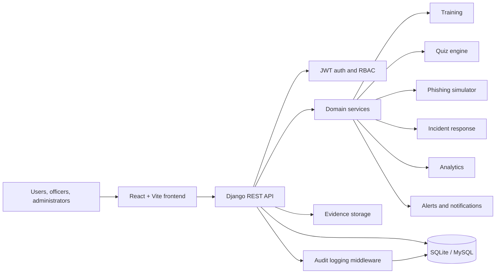
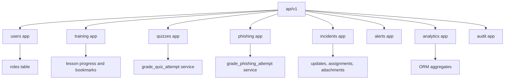
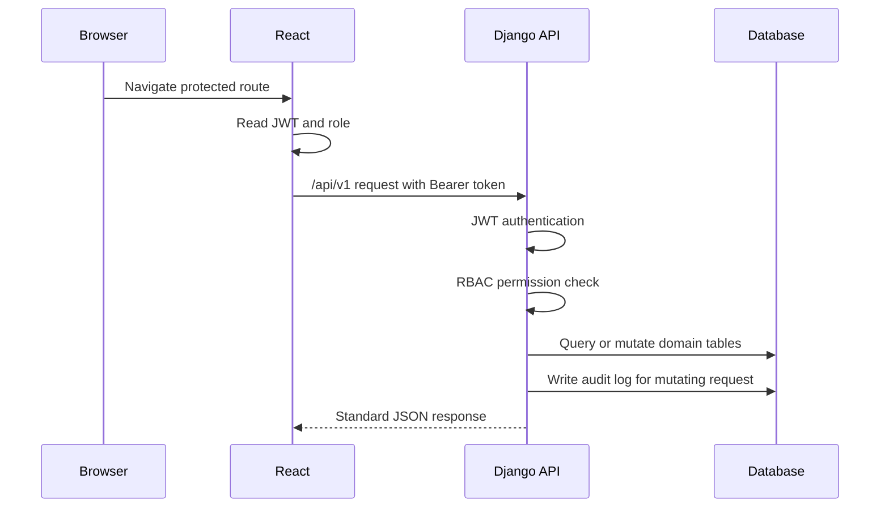

# CyberShield Hub Architecture

## System Diagram

## Backend Boundaries

## Request Flow

## Role Matrix

| Capability | Normal User | Cybersecurity Officer | System Administrator |
| --- | --- | --- | --- |
| Training and quizzes | Yes | Yes | Yes |
| Phishing simulations | Yes | Yes | Yes |
| Report incidents | Yes | Yes | Yes |
| View own incidents | Yes | Yes | Yes |
| Manage all incidents | No | Yes | Yes |
| View analytics | Own dashboard | Organization | Organization |
| Manage alerts | No | Yes | Yes |
| View audit logs | No | Yes | Yes |
| Manage users and roles | No | No | Yes |

## Data Flow Principles

- API versioning is rooted at `/api/v1/`.
- Models are normalized by domain and use foreign keys for ownership and workflow relationships.
- Services contain grading logic for quizzes and phishing attempts.
- Permissions enforce RBAC at viewset/action level.
- Middleware records mutating API calls in `audit_logs`.
- Upload validation constrains evidence files by extension and size.
- Frontend pages consume API services and use demo fallbacks only in development mode.
